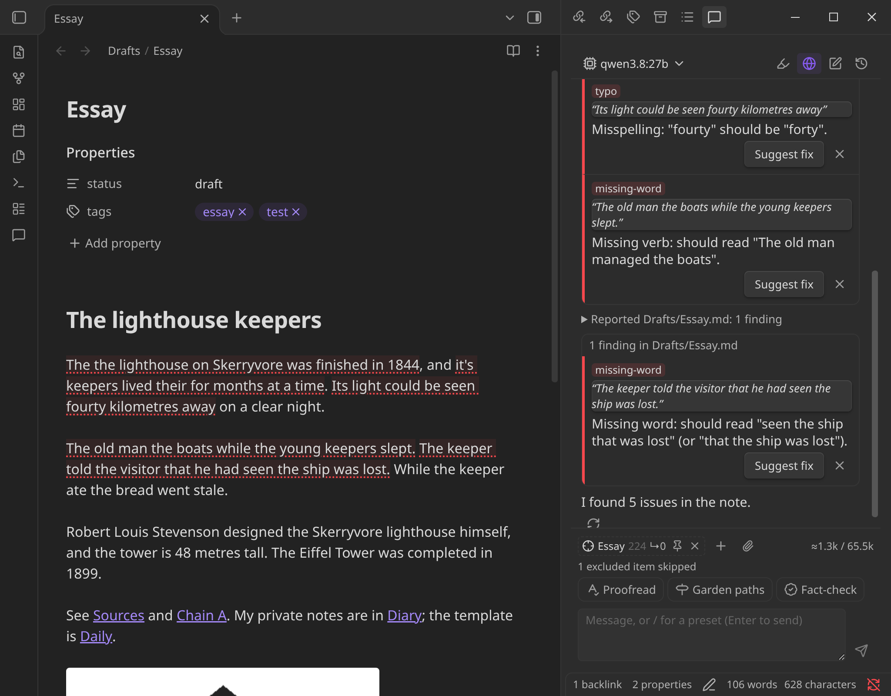
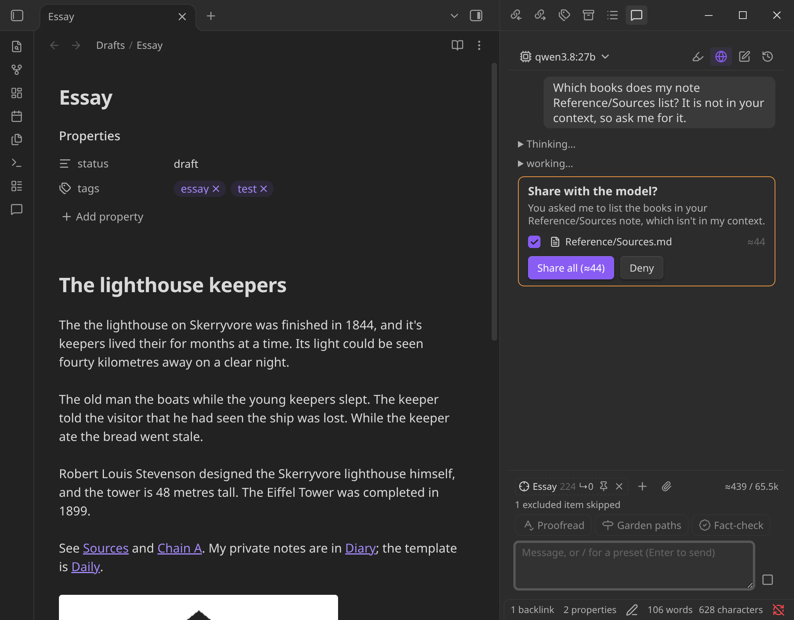

# Lektor

A chat in Obsidian's sidebar for working on your writing with a language model. It runs on a local model (Ollama, LM Studio, llama.cpp…), or on Claude Code or Codex with the subscription you already have.

Two rules hold everywhere:

- **It sees only what you give it.** The model gets the notes, selections and files shown as chips above the message box, and nothing else. If it needs more, it asks, and you decide.
- **It changes nothing without you.** Every edit it proposes is shown as a diff, and nothing in your vault changes until you accept a change, hunk by hunk. There is no setting that applies changes automatically.

## What it does

- **Chat about your notes.** Add the current note, a selection, a folder or an attachment as context. Linked notes can come along to a depth you choose. Excluded folders (and Obsidian's own excluded files) are never sent.
- **Asks before it reads more.** When a model wants a note you didn't give it, a card shows exactly what it asked for; share some, all or none.
- **Proposes edits you review.** Changes appear in the sidebar as a diff, or inline in the note with ✓ and ✕ on each hunk. Or, in Prose mode, the model just describes them. If you edit the note meanwhile, pending changes are re-anchored, and any that no longer fit are listed rather than applied.
- **Presets.** Proofread, Garden paths (sentences that lead the reader astray) and Fact-check are built in; write your own with a prompt, tools and a model. Findings are underlined in the note, with "Suggest fix" on each.
- **Web search, if you want it.** Tavily, Exa, Brave, SearXNG or DuckDuckGo, with caps per message. Pages that didn't come from a search, your messages or your notes need your approval before they're fetched. Claude Code and Codex search with their own tools by default, as in their own apps, and the chat says so.
- **AI edit history.** Every change you accepted is logged per note, including undo and redo in the editor.

## Models

- **Ollama** at any address (local by default).
- **OpenAI- or Anthropic-compatible endpoints**: LM Studio, vLLM, llama.cpp, gateways, or a cloud API with your own key.
- **Claude Code**: the official `claude` CLI on this computer, signed in with your Claude subscription. Off until you turn it on.
- **Codex**: the official `codex` CLI on this computer, signed in with your ChatGPT plan. Off until you turn it on.

Claude Code and Codex run locked down. Each runs in an empty temporary folder outside your vault, with its file and shell tools off and its own settings, hooks and MCP servers ignored, and it gets only Lektor's tools for your notes. Before the first chat each day, Lektor checks this on the installed version: if the CLI can read a file it shouldn't, or has a tool it shouldn't, the bridge stays off. Lektor never reads or copies your sign-in; it starts the CLI, which signs in by itself.

## Getting started

1. Open the sidebar with the ribbon icon or the command **Lektor: Open sidebar**.
2. Choose a model in the header. To use Ollama, install it and pull a model; for an endpoint, Claude Code or Codex, set it up in Lektor's settings first.
3. Open a note: it's added as context. Ask something, or click a preset below the message box.

Every action is also in the command palette under "Lektor". None has a default hotkey; bind the ones you like in Settings → Hotkeys.

## Network use

Lektor itself connects only to:

- the model servers you set up (Ollama, your endpoints);
- the web search provider you choose, if any, and the pages it fetches for the model;
- nothing else: no update checks, analytics or other services of its own.

Claude Code and Codex, when you turn them on, contact Anthropic's and OpenAI's services themselves, as they do when you use them directly. They search the web through those services unless you hand web work to Lektor in settings.

## Accounts

- **Claude Code** needs Claude Code installed and signed in with a Claude subscription. Replies count against your plan.
- **Codex** needs the Codex CLI installed and signed in with a ChatGPT plan. Replies count against your plan.
- **Tavily, Exa and Brave** search need an API key from that service; SearXNG needs a server address; DuckDuckGo needs neither.
- **Endpoints** may need an API key, depending on the server.

Keys are kept in Obsidian's secret storage, not in Lektor's settings file.

## Privacy

- **No telemetry.** Lektor collects nothing about you or your use of it.
- **Chats** are saved in Lektor's plugin folder with the list of notes that were sent (paths and hashes), not their contents, unless you turn on full transcripts. Replies themselves are kept, and may quote your notes; when you delete a note, Lektor offers to delete the chats that sent it.
- **Outside your vault**, Lektor uses the system's temporary folder for Claude Code and Codex runs (removed afterwards) and starts those CLIs as programs. That is why Lektor works on desktop only.

## Licence

AGPL-3.0-or-later; see [LICENSE](LICENSE). Third-party code and packages are listed in [THIRD_PARTY.md](THIRD_PARTY.md).
