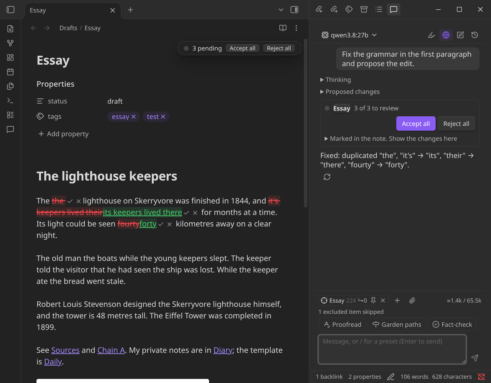

# Lektor

A chat in Obsidian's sidebar for working on your writing with a language model. It runs on a local model (Ollama, LM Studio, llama.cpp…), or on Claude Code or Codex with the subscription you already have.

Two rules hold everywhere:

- **It sees only what you give it.** The model gets the notes, selections and files shown as chips above the message box, and nothing else. If it needs more, it asks, and you decide.
- **It changes nothing without you.** Every edit it proposes is shown as a diff, and nothing in your vault changes until you accept a change, hunk by hunk. There is no setting that applies changes automatically.

## Privacy and network use

### What the model sees and changes

- The model sees only the context you attach: the chips above the message box. When it asks for more, you choose what to share, if anything.
- Nothing in your vault changes until you accept a proposed change, hunk by hunk.

### Network use

Lektor itself connects only to:

- **the model servers you set up**: Ollama or another local server, or any OpenAI- or Anthropic-compatible URL you enter, to send your messages and the context you attached;
- **the web search provider you choose**, if any (Tavily, Exa, Brave, SearXNG or DuckDuckGo), only for searches the model makes;
- **web pages the model fetches**, for example while fact-checking; pages that didn't come from a search, your messages or your notes need your approval first.

When you turn on Claude Code or Codex, those programs contact Anthropic's or OpenAI's services themselves, as they do when you use them directly, including for their own web searches. While one of them is answering, Lektor listens on 127.0.0.1 (a random port, with a token for that reply) so the program can call Lektor's tools; nothing outside your computer can reach it.

There is no telemetry and no analytics, no update checks, and no other network calls.

### Accounts

Core features work with a local model and no account.

- **Claude Code** needs Claude Code installed and signed in with a Claude subscription; replies count against your plan.
- **Codex** needs the Codex CLI installed and signed in with a ChatGPT plan; replies count against your plan.
- **Tavily, Exa and Brave** search need an account and API key from that service; SearXNG needs a server address; DuckDuckGo needs neither.
- **Endpoints** may need an API key, depending on the server.

Keys are kept in Obsidian's secret storage, not in Lektor's settings file.

### Files outside the vault

- **Programs.** Lektor runs the `claude` and `codex` programs installed on your computer (from your PATH, or a path you set). That is why it works on desktop only.
- **Temporary folders.** For each reply it creates a private folder in the system's temporary folder (`lektor-…`), with an empty working folder for the program, so the program never runs in your vault, plus the files that run needs: Lektor's fixed instructions, how to reach Lektor's tools, and for Codex its model list and any images you attached. The folder is removed when the reply ends. For Codex, one empty working folder serves the whole Obsidian session and is removed when Lektor unloads.
- **Sign-in.** Each program signs in by itself, from its own files: Claude Code from its stored login, Codex from your `~/.codex`. Lektor never reads, copies or sends your sign-in or any token. For Codex, Lektor tells it to ignore its settings, MCP servers and other configuration there and to keep its state and logs in the temporary folder; Codex may still refresh its own list of models in `~/.codex`.
- **Chats and settings** are kept in Lektor's own folder inside your vault's configuration folder. Chat history records which notes were sent (paths and hashes), not their contents, unless you turn on full transcripts; replies themselves are kept and may quote your notes. When you delete a note, Lektor offers to delete the chats that sent it.

## What it does

- **Chat about your notes.** Add the current note, a selection, a folder or an attachment as context. Linked notes can come along to a depth you choose. Excluded folders (and Obsidian's own excluded files) are never sent.
- **Asks before it reads more.** When a model wants a note you didn't give it, a card shows exactly what it asked for; share some, all or none.
- **Proposes edits you review.** Changes appear in the sidebar as a diff, or inline in the note with ✓ and ✕ on each hunk. Or, in Prose mode, the model just describes them. If you edit the note meanwhile, pending changes are re-anchored, and any that no longer fit are listed rather than applied.
- **Presets.** Proofread, Garden paths (sentences that lead the reader astray) and Fact-check are built in; write your own with a prompt, tools and a model. Findings are underlined in the note, with "Suggest fix" on each.
- **Web search, if you want it.** Tavily, Exa, Brave, SearXNG or DuckDuckGo, with caps per message. Pages that didn't come from a search, your messages or your notes need your approval before they're fetched. Claude Code and Codex search with their own tools by default, as in their own apps, and the chat says so.
- **AI edit history.** Every change you accepted is logged per note, including undo and redo in the editor.

## Models

- **Ollama** at any address (local by default).
- **OpenAI- or Anthropic-compatible endpoints**: LM Studio, vLLM, llama.cpp, gateways, or a cloud API with your own key.
- **Claude Code**: the official `claude` CLI on this computer, signed in with your Claude subscription. Off until you turn it on.
- **Codex**: the official `codex` CLI on this computer, signed in with your ChatGPT plan. Off until you turn it on.

Claude Code and Codex run locked down. Each runs in an empty temporary folder outside your vault, with its file and shell tools off and its own settings, hooks and MCP servers ignored, and it gets only Lektor's tools for your notes. Before the first chat each day, Lektor checks this on the installed version: if the CLI can read a file it shouldn't, or has a tool it shouldn't, the bridge stays off. Lektor never reads or copies your sign-in; it starts the CLI, which signs in by itself.

## Getting started

1. Open the sidebar with the ribbon icon or the command **Lektor: Open sidebar**.
2. Choose a model in the header. To use Ollama, install it and pull a model; for an endpoint, Claude Code or Codex, set it up in Lektor's settings first.
3. Open a note: it's added as context. Ask something, or click a preset below the message box.

Every action is also in the command palette under "Lektor". None has a default hotkey; bind the ones you like in Settings → Hotkeys.

## Licence and credits

AGPL-3.0-or-later; see [LICENSE](LICENSE). Bundled packages and their licences are listed in [THIRD_PARTY.md](THIRD_PARTY.md).

Lektor's design drew on two MIT-licensed Obsidian plugins: [LLM Hub](https://github.com/takeshy/obsidian-llm-hub) (running CLI models from Obsidian, and serving tools to them over MCP) and [Smart Composer](https://github.com/glowingjade/obsidian-smart-composer) (reviewing proposed edits block by block). Lektor contains no code from either.
